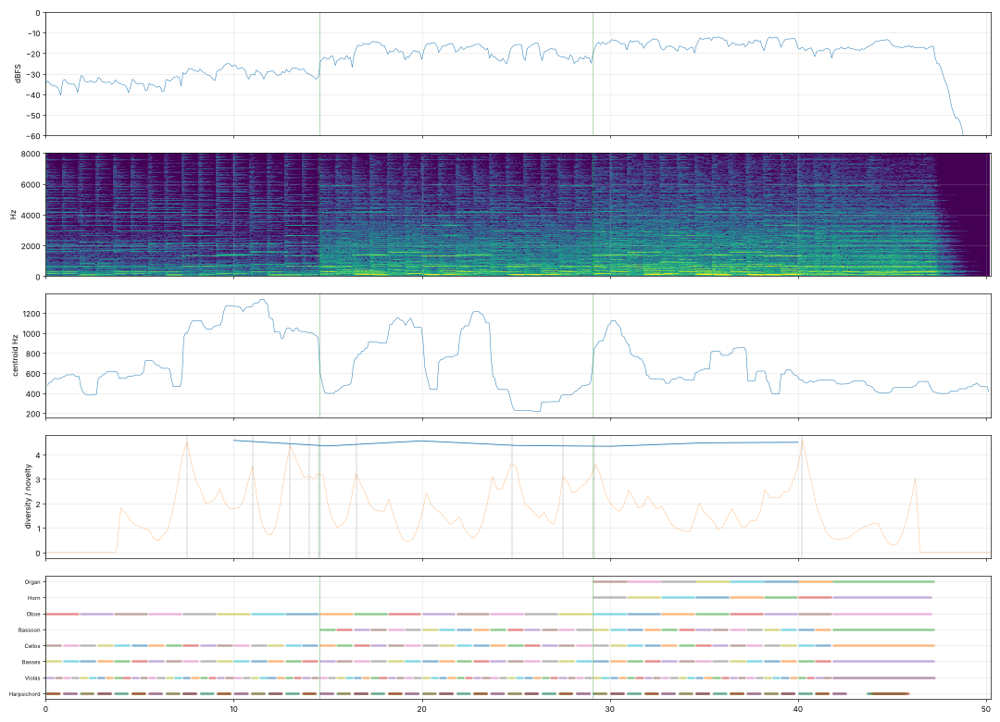

# Report: Хоральная прелюдия ре минор

- length 50.3 s; level p10/p50/p90 -34.4/-18.9/-14.1 dBFS; peak -1.0 dBFS
- gaps ≥ 1 s below −50 dBFS: none
- clipped samples: 0; isolated clicks at: none
- centroid median 577 Hz; share above 2 kHz median -21.8 dB
- flat stretches (diversity < 60 % of the median, 20 s windows): none
- strongest changes (novelty peaks), s: [7.5, 11.0, 13.0, 14.0, 14.5, 16.5, 24.8, 27.5, 29.2, 40.2]

## Score
- notes: 453, parts: 8, densest 10 s: 114 notes at 30–… s
- outside the real range of the instrument (matters for live players): {'cb_pizz': 2, 'cb_sus': 6}
- more than 5 semitones beyond the recorded range (resampled, may sound artificial): {'org_quiet': 4}

## Balance (each part alone, LUFS while it plays; the tune and the bass usually within ±3 dB)

| part | LUFS |
|---|---|
| Cellos | -22.6 |
| Oboe | -22.6 |
| Bassoon | -26.1 |
| Violas | -29.5 |
| Basses | -31.5 |
| Horn | -32.8 |
| Harpsichord | -37.4 |
| Organ | -41.6 |

