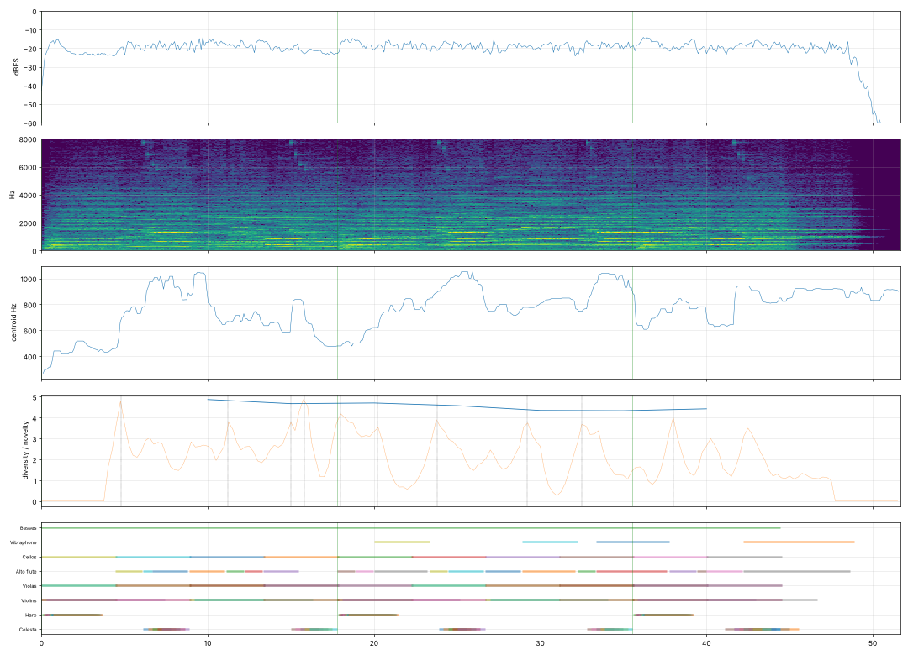

# Report: Ноктюрн

- length 51.7 s; level p10/p50/p90 -23.0/-19.2/-16.5 dBFS; peak -1.0 dBFS
- gaps ≥ 1 s below −50 dBFS: none
- clipped samples: 0; isolated clicks at: none
- centroid median 786 Hz; share above 2 kHz median -18.3 dB
- flat stretches (diversity < 60 % of the median, 20 s windows): none
- strongest changes (novelty peaks), s: [4.8, 11.2, 15.0, 15.8, 18.0, 20.2, 23.8, 29.2, 32.5, 38.0]

## Score
- notes: 143, parts: 8, densest 10 s: 37 notes at 0–… s
- outside the real range of the instrument (matters for live players): {'vibes': 1}
- more than 5 semitones beyond the recorded range (resampled, may sound artificial): none

## Balance (each part alone, LUFS while it plays; the tune and the bass usually within ±3 dB)

| part | LUFS |
|---|---|
| Alto flute | -29.1 |
| Harp | -30.3 |
| Celesta | -33.8 |
| Cellos | -38.8 |
| Violins | -38.8 |
| Basses | -40.3 |
| Violas | -40.3 |
| Vibraphone | -41.9 |

