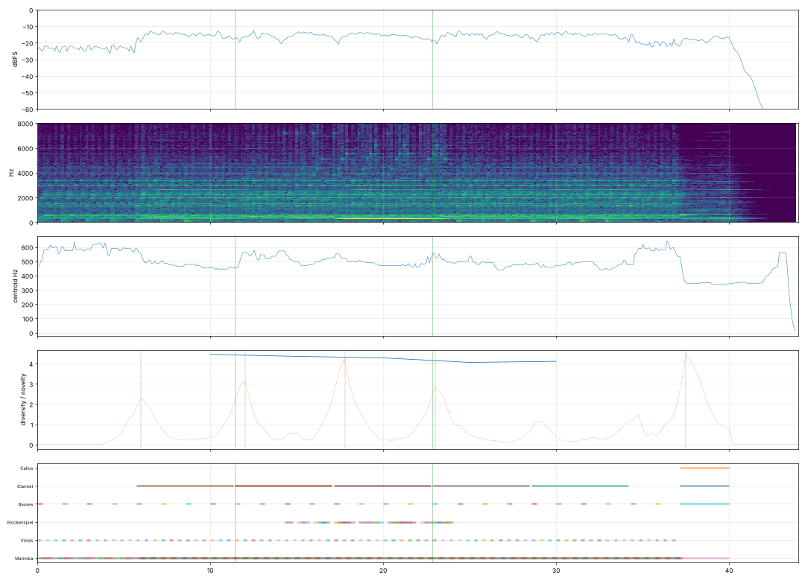

# Report: Фаза

- length 44.0 s; level p10/p50/p90 -23.2/-16.1/-14.2 dBFS; peak -1.0 dBFS
- gaps ≥ 1 s below −50 dBFS: none
- clipped samples: 0; isolated clicks at: none
- centroid median 487 Hz; share above 2 kHz median -18.2 dB
- flat stretches (diversity < 60 % of the median, 20 s windows): none
- strongest changes (novelty peaks), s: [6.0, 12.0, 17.8, 23.0, 37.5]

## Score
- notes: 722, parts: 6, densest 10 s: 215 notes at 10–… s
- outside the real range of the instrument (matters for live players): none
- more than 5 semitones beyond the recorded range (resampled, may sound artificial): none

