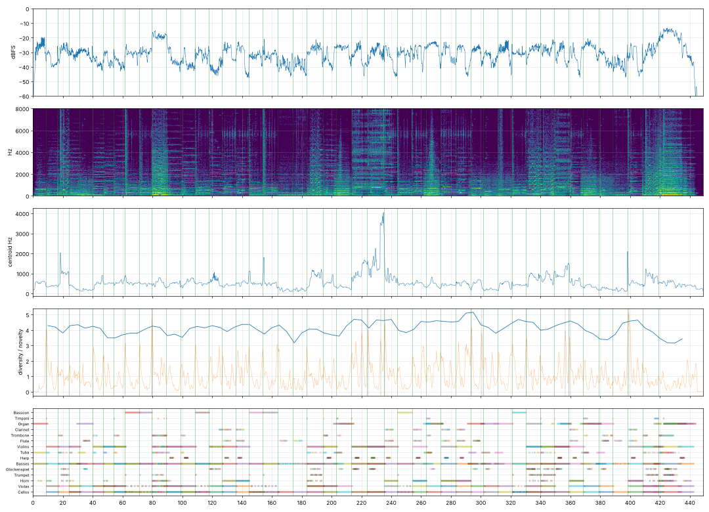

# Report: Р.С.Ф.Г.Р. 1920–2000

- length 448.9 s; level p10/p50/p90 -39.9/-30.9/-24.3 dBFS; peak -1.0 dBFS
- gaps ≥ 1 s below −50 dBFS: none
- clipped samples: 0; isolated clicks at: none
- centroid median 486 Hz; share above 2 kHz median -21.2 dB
- flat stretches (diversity < 60 % of the median, 20 s windows): none
- strongest changes (novelty peaks), s: [9.0, 79.8, 220.2, 224.5, 232.8, 235.8, 293.8, 300.5, 330.8, 356.5, 359.5, 399.0]

## Score
- notes: 1520, parts: 15, densest 10 s: 107 notes at 410–… s
- outside the real range of the instrument (matters for live players): {'vla_pizz': 20, 'cb_pizz': 20, 'tba_sus': 4, 'tbn_sus': 4, 'tpt_sus': 2}
- more than 5 semitones beyond the recorded range (resampled, may sound artificial): {'cb_sus': 9, 'tba_sus': 9, 'org_quiet': 5}

