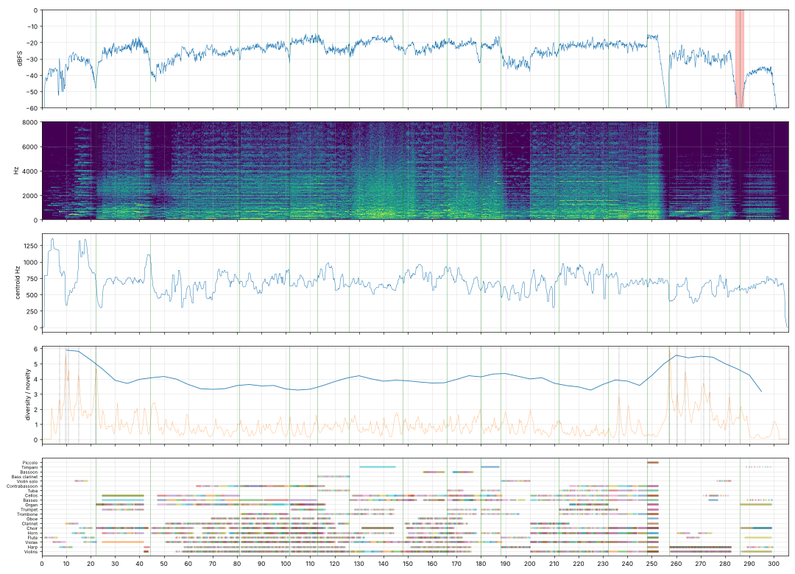

# Report: Ainulindalë

- length 306.0 s; level p10/p50/p90 -36.7/-24.6/-19.4 dBFS; peak -1.0 dBFS
- gaps ≥ 1 s below −50 dBFS: [(284.2, 287.7)]
- clipped samples: 0; isolated clicks at: none
- centroid median 680 Hz; share above 2 kHz median -15.2 dB
- flat stretches (diversity < 60 % of the median, 20 s windows): none
- strongest changes (novelty peaks), s: [7.2, 9.8, 11.0, 15.0, 22.2, 236.5, 257.2, 260.5, 263.8, 271.2, 273.8, 281.8]

## Score
- notes: 5494, parts: 20, densest 10 s: 466 notes at 90–… s
- outside the real range of the instrument (matters for live players): {'hn_sus': 1}
- more than 5 semitones beyond the recorded range (resampled, may sound artificial): none

## Balance (each part alone, LUFS while it plays; the tune and the bass usually within ±3 dB)

| part | LUFS |
|---|---|
| Choir | -16.7 |
| Trumpet | -20.4 |
| Cellos | -22.8 |
| Violins | -22.8 |
| Horn | -24.7 |
| Violas | -24.7 |
| Harp | -25.6 |
| Timpani | -26.3 |
| Organ | -26.6 |
| Trombone | -27.0 |
| Basses | -27.4 |
| Contrabassoon | -27.6 |
| Clarinet | -28.5 |
| Flute | -29.1 |
| Bass clarinet | -29.4 |
| Piccolo | -29.6 |
| Violin solo | -30.1 |
| Tuba | -30.8 |
| Oboe | -31.4 |
| Bassoon | -31.5 |

