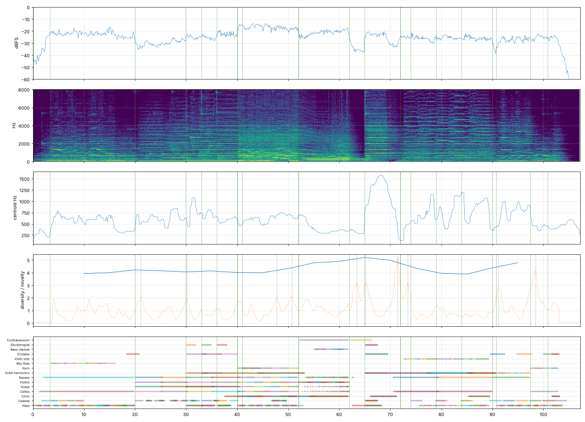

# Report: Aldudénië

- length 107.2 s; level p10/p50/p90 -32.1/-24.9/-18.4 dBFS; peak -1.0 dBFS
- gaps ≥ 1 s below −50 dBFS: none
- clipped samples: 0; isolated clicks at: none
- centroid median 581 Hz; share above 2 kHz median -17.8 dB
- flat stretches (diversity < 60 % of the median, 20 s windows): none
- strongest changes (novelty peaks), s: [21.2, 30.2, 47.8, 50.8, 63.5, 65.2, 71.5, 73.5, 91.2, 98.5]

## Score
- notes: 619, parts: 15, densest 10 s: 128 notes at 50–… s
- outside the real range of the instrument (matters for live players): none
- more than 5 semitones beyond the recorded range (resampled, may sound artificial): none

## Balance (each part alone, LUFS while it plays; the tune and the bass usually within ±3 dB)

| part | LUFS |
|---|---|
| Choir | -23.0 |
| Alto flute | -26.4 |
| Horn | -29.3 |
| Contrabassoon | -29.7 |
| Violin solo | -30.3 |
| Violin harmonics | -30.6 |
| Cellos | -31.7 |
| Violins | -33.7 |
| Violas | -34.4 |
| Harp | -34.5 |
| Bass clarinet | -35.6 |
| Celesta | -36.9 |
| Basses | -38.1 |
| Crotales | -39.3 |
| Glockenspiel | -47.4 |

