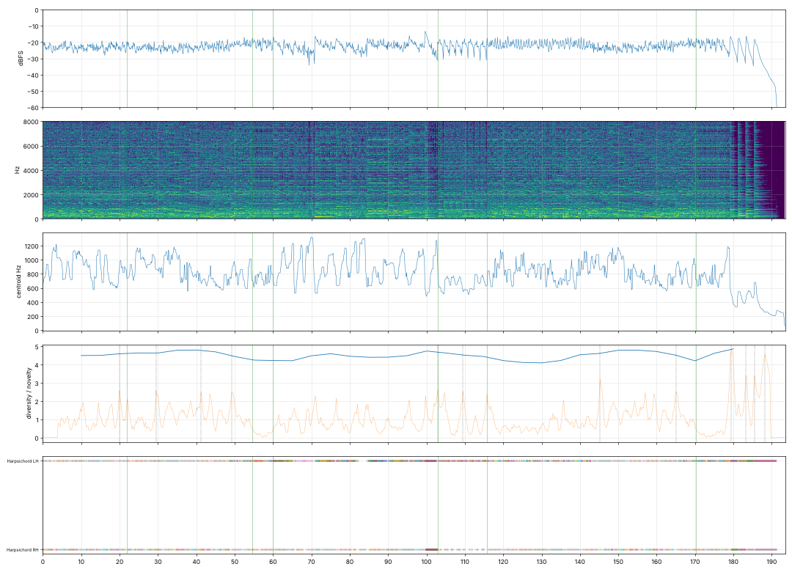

# Report: Praeludium es-moll

- length 193.6 s; level p10/p50/p90 -25.9/-22.5/-19.4 dBFS; peak -1.0 dBFS
- gaps ≥ 1 s below −50 dBFS: none
- clipped samples: 0; isolated clicks at: none
- centroid median 791 Hz; share above 2 kHz median -11.3 dB
- flat stretches (diversity < 60 % of the median, 20 s windows): none
- strongest changes (novelty peaks), s: [20.0, 29.5, 41.2, 49.2, 103.0, 109.5, 145.2, 165.0, 179.5, 183.2, 185.5, 188.2]

## Score
- notes: 1907, parts: 2, densest 10 s: 130 notes at 130–… s
- outside the real range of the instrument (matters for live players): none
- more than 5 semitones beyond the recorded range (resampled, may sound artificial): none

## Balance (each part alone, LUFS while it plays; the tune and the bass usually within ±3 dB)

| part | LUFS |
|---|---|
| Harpsichord RH | -39.3 |
| Harpsichord LH | -39.4 |

