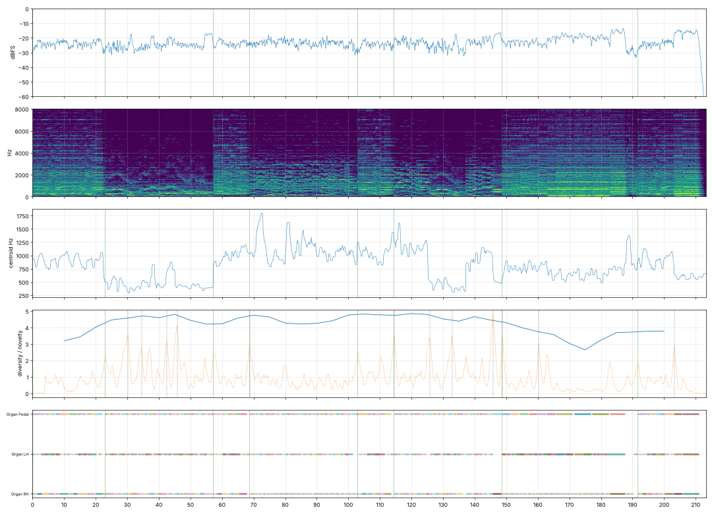

# Report: Praeludium d-moll (Призрак Оперы, как написал бы Бах)

- length 213.3 s; level p10/p50/p90 -27.5/-23.5/-18.5 dBFS; peak -1.0 dBFS
- gaps ≥ 1 s below −50 dBFS: none
- clipped samples: 0; isolated clicks at: none
- centroid median 822 Hz; share above 2 kHz median -14.7 dB
- flat stretches (diversity < 60 % of the median, 20 s windows): none
- strongest changes (novelty peaks), s: [30.2, 34.5, 42.5, 45.8, 68.8, 114.5, 125.8, 132.8, 145.8, 148.8, 160.2, 203.2]

## Score
- notes: 1336, parts: 3, densest 10 s: 101 notes at 90–… s
- outside the real range of the instrument (matters for live players): none
- more than 5 semitones beyond the recorded range (resampled, may sound artificial): none

## Balance (each part alone, LUFS while it plays; the tune and the bass usually within ±3 dB)

| part | LUFS |
|---|---|
| Organ RH | -29.7 |
| Organ LH | -30.7 |
| Organ Pedal | -32.1 |

