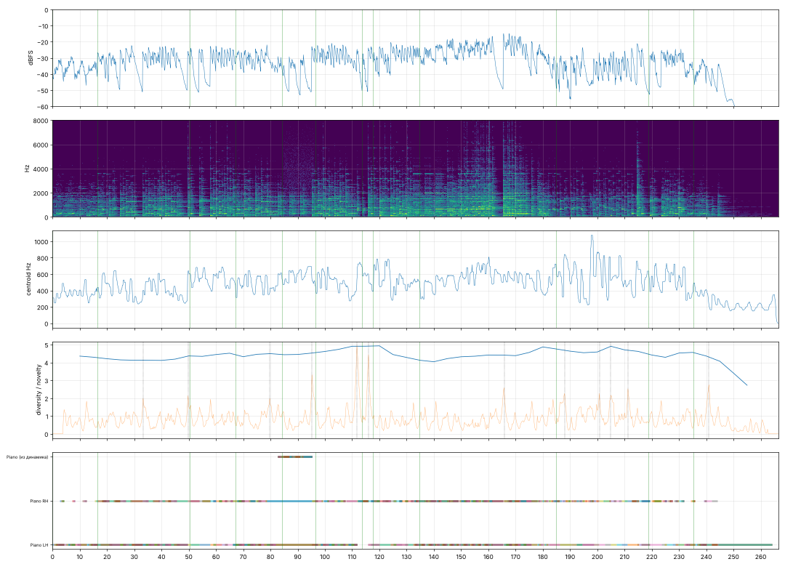

# Report: Moment musical «18 берёз»

- length 266.5 s; level p10/p50/p90 -45.1/-31.8/-24.0 dBFS; peak -1.0 dBFS
- gaps ≥ 1 s below −50 dBFS: none
- clipped samples: 0; isolated clicks at: none
- centroid median 486 Hz; share above 2 kHz median -28.0 dB
- flat stretches (diversity < 60 % of the median, 20 s windows): none
- strongest changes (novelty peaks), s: [33.2, 49.8, 79.8, 95.2, 111.8, 116.0, 165.8, 188.0, 200.8, 205.0, 211.2, 241.0]

## Score
- notes: 911, parts: 3, densest 10 s: 72 notes at 140–… s
- outside the real range of the instrument (matters for live players): {'piano': 3}
- more than 5 semitones beyond the recorded range (resampled, may sound artificial): none

## Balance (each part alone, LUFS while it plays; the tune and the bass usually within ±3 dB)

| part | LUFS |
|---|---|
| Piano RH | -35.3 |
| Piano LH | -37.7 |
| Piano (из динамика) | -37.9 |

