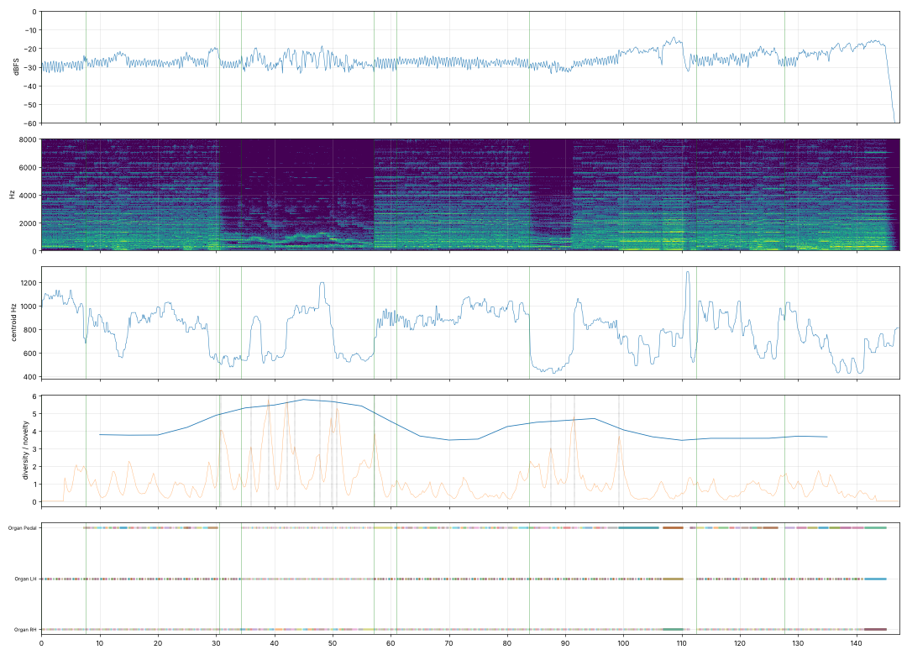

# Report: Toccata «Le Fantôme»

- length 147.4 s; level p10/p50/p90 -30.2/-26.6/-20.4 dBFS; peak -1.0 dBFS
- gaps ≥ 1 s below −50 dBFS: none
- clipped samples: 0; isolated clicks at: none
- centroid median 802 Hz; share above 2 kHz median -12.9 dB
- flat stretches (diversity < 60 % of the median, 20 s windows): none
- strongest changes (novelty peaks), s: [30.8, 36.0, 39.0, 42.2, 43.5, 47.8, 49.8, 50.8, 57.2, 87.5, 91.5, 99.2]

## Score
- notes: 2170, parts: 3, densest 10 s: 169 notes at 10–… s
- outside the real range of the instrument (matters for live players): none
- more than 5 semitones beyond the recorded range (resampled, may sound artificial): none

## Balance (each part alone, LUFS while it plays; the tune and the bass usually within ±3 dB)

| part | LUFS |
|---|---|
| Organ Pedal | -27.1 |
| Organ LH | -28.2 |
| Organ RH | -28.3 |

