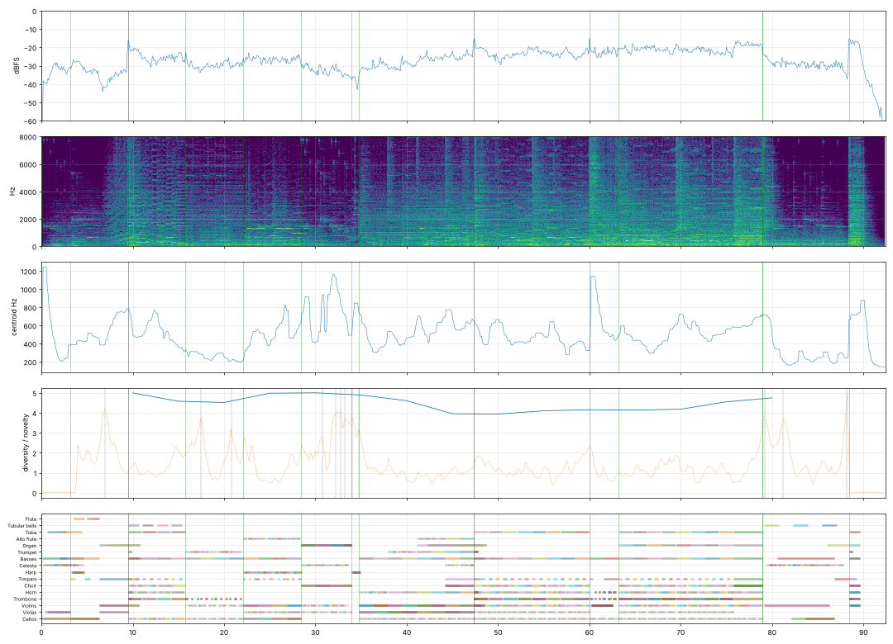

# Report: Холодный мир — опенинг

- length 92.4 s; level p10/p50/p90 -33.7/-26.4/-20.3 dBFS; peak -1.0 dBFS
- gaps ≥ 1 s below −50 dBFS: none
- clipped samples: 0; isolated clicks at: none
- centroid median 470 Hz; share above 2 kHz median -17.1 dB
- flat stretches (diversity < 60 % of the median, 20 s windows): none
- strongest changes (novelty peaks), s: [7.0, 17.5, 20.8, 30.8, 32.2, 32.8, 33.2, 34.0, 34.8, 79.2, 81.2, 88.2]

## Score
- notes: 1804, parts: 16, densest 10 s: 338 notes at 60–… s
- outside the real range of the instrument (matters for live players): {'choir': 1, 'harp': 2}
- more than 5 semitones beyond the recorded range (resampled, may sound artificial): {'cb_sus': 2, 'tba_sus': 2, 'harp': 1}

## Balance (each part alone, LUFS while it plays; the tune and the bass usually within ±3 dB)

| part | LUFS |
|---|---|
| Choir | -22.1 |
| Trumpet | -23.0 |
| Horn | -23.5 |
| Alto flute | -24.7 |
| Basses | -25.4 |
| Cellos | -25.5 |
| Violins | -27.0 |
| Trombone | -27.2 |
| Celesta | -27.3 |
| Organ | -27.6 |
| Flute | -28.8 |
| Timpani | -29.7 |
| Violas | -29.7 |
| Harp | -31.1 |
| Tuba | -32.4 |
| Tubular bells | -45.1 |

