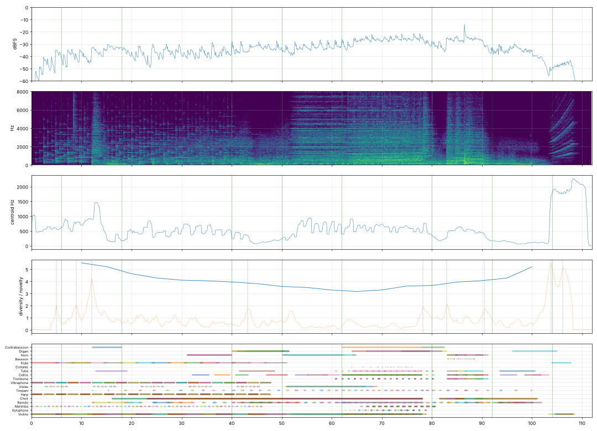

# Report: Devoratio

- length 112.0 s; level p10/p50/p90 -44.5/-34.1/-26.1 dBFS; peak -1.0 dBFS
- gaps ≥ 1 s below −50 dBFS: none
- clipped samples: 0; isolated clicks at: none
- centroid median 489 Hz; share above 2 kHz median -16.9 dB
- flat stretches (diversity < 60 % of the median, 20 s windows): none
- strongest changes (novelty peaks), s: [5.0, 9.0, 12.0, 43.2, 78.2, 83.0, 90.5, 103.8, 106.2]

## Score
- notes: 1633, parts: 18, densest 10 s: 578 notes at 70–… s
- outside the real range of the instrument (matters for live players): {'vln_colleg': 15}
- more than 5 semitones beyond the recorded range (resampled, may sound artificial): {'cb_sus': 3, 'tba_sus': 3, 'hn_mute': 1}

## Balance (each part alone, LUFS while it plays; the tune and the bass usually within ±3 dB)

| part | LUFS |
|---|---|
| Choir | -20.8 |
| Timpani | -25.2 |
| Contrabassoon | -28.3 |
| Basses | -29.1 |
| Cellos | -29.8 |
| Tuba | -29.9 |
| Marimba | -30.6 |
| Violins | -30.6 |
| Horn | -31.0 |
| Xylophone | -31.3 |
| Organ | -31.8 |
| Violas | -31.8 |
| Trombone | -32.1 |
| Harp | -33.0 |
| Vibraphone | -34.5 |
| Flute | -36.3 |
| Bassoon | -36.8 |
| Crotales | -43.4 |

