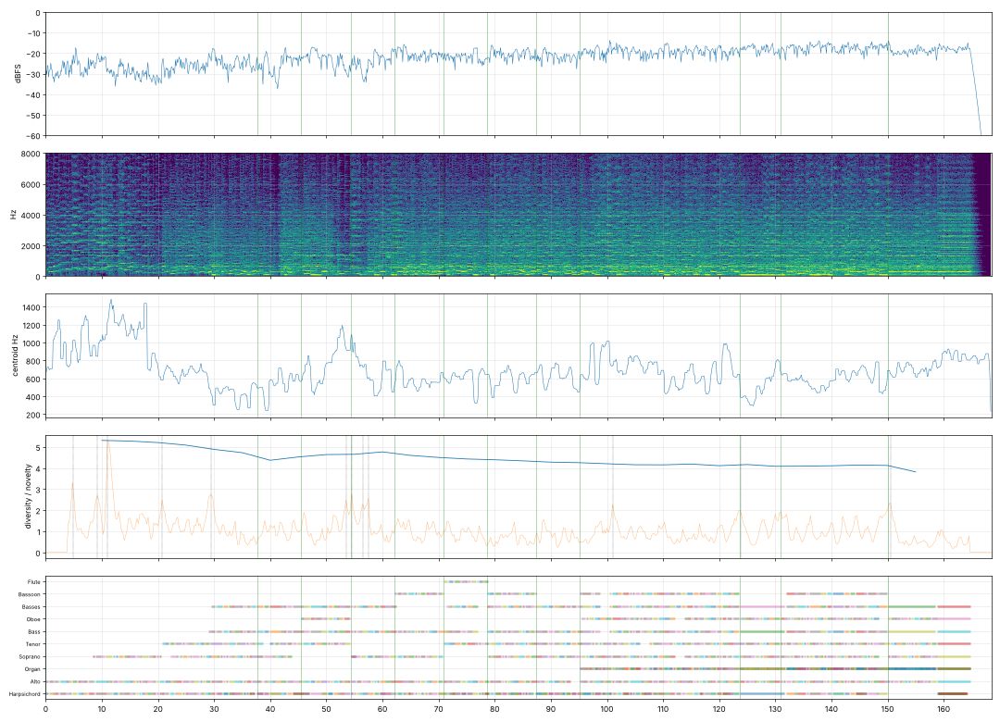

# Report: Fuga: Die Grenzen meiner Sprache

- length 168.6 s; level p10/p50/p90 -28.9/-20.9/-17.0 dBFS; peak -1.0 dBFS
- gaps ≥ 1 s below −50 dBFS: none
- clipped samples: 0; isolated clicks at: none
- centroid median 655 Hz; share above 2 kHz median -13.8 dB
- flat stretches (diversity < 60 % of the median, 20 s windows): none
- strongest changes (novelty peaks), s: [4.8, 9.2, 11.0, 20.8, 29.5, 53.5, 54.5, 56.5, 57.5, 101.0, 123.8, 150.5]

## Score
- notes: 1693, parts: 10, densest 10 s: 163 notes at 110–… s
- outside the real range of the instrument (matters for live players): {'vln_sus': 2, 'cb_sus': 1}
- more than 5 semitones beyond the recorded range (resampled, may sound artificial): none

## Balance (each part alone, LUFS while it plays; the tune and the bass usually within ±3 dB)

| part | LUFS |
|---|---|
| Bass | -23.0 |
| Alto | -24.1 |
| Bassoon | -24.1 |
| Oboe | -25.3 |
| Flute | -25.6 |
| Tenor | -25.8 |
| Soprano | -25.9 |
| Organ | -28.7 |
| Harpsichord | -30.3 |
| Basses | -30.9 |

