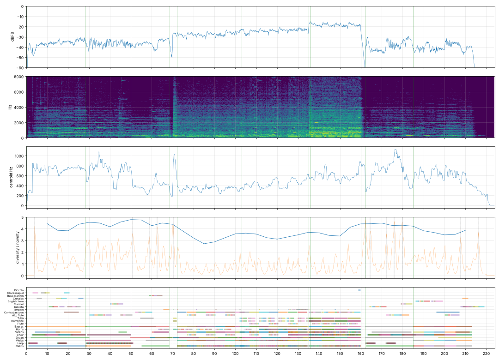

# Report: Искушение Галадриэли

- length 224.1 s; level p10/p50/p90 -42.6/-33.6/-19.6 dBFS; peak -1.0 dBFS
- gaps ≥ 1 s below −50 dBFS: none
- clipped samples: 0; isolated clicks at: none
- centroid median 519 Hz; share above 2 kHz median -20.1 dB
- flat stretches (diversity < 60 % of the median, 20 s windows): none
- strongest changes (novelty peaks), s: [4.0, 50.8, 58.8, 62.5, 70.2, 162.2, 164.5, 172.2, 176.0, 179.8, 207.8, 216.2]

## Score
- notes: 1541, parts: 21, densest 10 s: 195 notes at 120–… s
- outside the real range of the instrument (matters for live players): {'tba_sus': 1, 'tbn_sus': 1, 'org_loud': 5}
- more than 5 semitones beyond the recorded range (resampled, may sound artificial): {'cb_sus': 1, 'tba_sus': 1}

## Balance (each part alone, LUFS while it plays; the tune and the bass usually within ±3 dB)

| part | LUFS |
|---|---|
| Choir | -14.0 |
| Contrabassoon | -15.7 |
| Piccolo | -17.1 |
| Cellos | -21.1 |
| Flute | -23.0 |
| Organ | -25.2 |
| Tuba | -25.7 |
| Violas | -26.0 |
| Alto flute | -26.2 |
| Horns | -26.4 |
| Clarinet | -27.7 |
| Bass clarinet | -30.4 |
| Harp | -30.6 |
| English horn | -31.0 |
| Basses | -31.3 |
| Violins | -31.4 |
| Timpani | -31.7 |
| Celesta | -35.0 |
| Trombone | -36.1 |
| Glockenspiel | -38.9 |
| Crotales | -39.9 |

