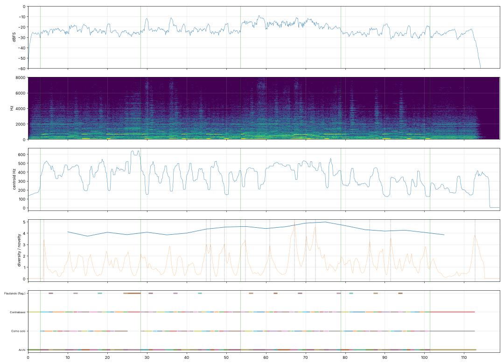

# Report: «Холодный мир» — тема Гернота

- length 119.0 s; level p10/p50/p90 -27.8/-23.5/-16.1 dBFS; peak -1.0 dBFS
- gaps ≥ 1 s below −50 dBFS: none
- clipped samples: 0; isolated clicks at: none
- centroid median 360 Hz; share above 2 kHz median -33.9 dB
- flat stretches (diversity < 60 % of the median, 20 s windows): none
- strongest changes (novelty peaks), s: [4.0, 45.0, 46.0, 49.5, 54.8, 61.0, 67.2, 70.2, 72.5, 86.2, 91.5, 112.8]

## Score
- notes: 374, parts: 4, densest 10 s: 44 notes at 40–… s
- outside the real range of the instrument (matters for live players): none
- more than 5 semitones beyond the recorded range (resampled, may sound artificial): none

## Balance (each part alone, LUFS while it plays; the tune and the bass usually within ±3 dB)

| part | LUFS |
|---|---|
| Corno solo | -33.0 |
| Contrabassi | -36.0 |
| Archi | -40.8 |
| Flautando (flag.) | -43.3 |

