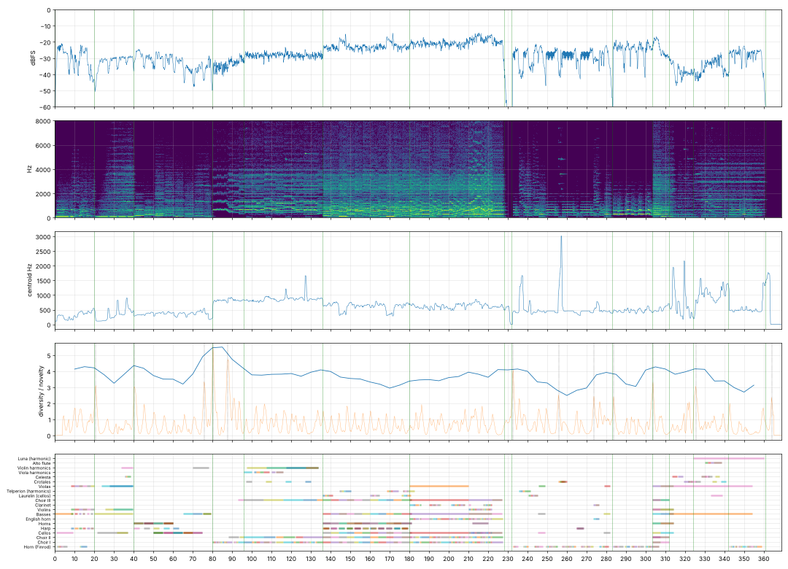

# Report: Hora Lucis Defunctae

- length 369.0 s; level p10/p50/p90 -38.6/-27.8/-20.6 dBFS; peak -1.0 dBFS
- gaps ≥ 1 s below −50 dBFS: none
- clipped samples: 0; isolated clicks at: none
- centroid median 529 Hz; share above 2 kHz median -20.5 dB
- flat stretches (diversity < 60 % of the median, 20 s windows): none
- strongest changes (novelty peaks), s: [20.8, 40.2, 75.8, 80.2, 87.8, 232.8, 255.8, 273.8, 283.8, 303.8, 325.5, 364.0]

## Score
- notes: 667, parts: 20, densest 10 s: 76 notes at 210–… s
- outside the real range of the instrument (matters for live players): none
- more than 5 semitones beyond the recorded range (resampled, may sound artificial): none

## Balance (each part alone, LUFS while it plays; the tune and the bass usually within ±3 dB)

| part | LUFS |
|---|---|
| Horn (Finrod) | -30.9 |
| Choir I | -31.3 |
| Choir II | -33.3 |
| Violins | -34.2 |
| Clarinet | -34.7 |
| Basses | -35.2 |
| English horn | -36.2 |
| Alto flute | -36.6 |
| Horns | -37.6 |
| Choir III | -38.1 |
| Telperion (harmonics) | -39.0 |
| Laurelin (cellos) | -39.2 |
| Harp | -40.1 |
| Crotales | -40.4 |
| Celesta | -41.2 |
| Cellos | -42.6 |
| Luna (harmonic) | -43.4 |
| Violin harmonics | -46.7 |
| Violas | -51.9 |
| Viola harmonics | -53.7 |

