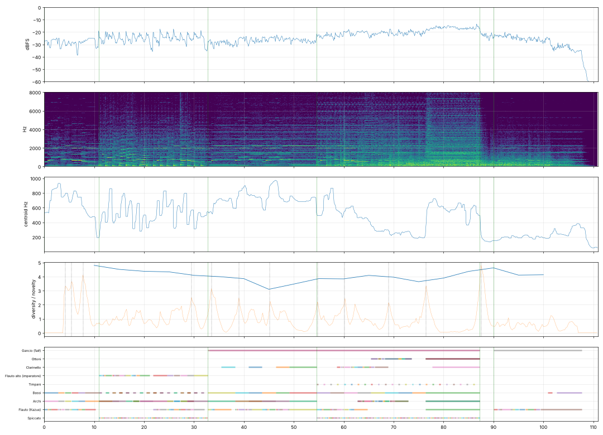

# Report: «Холодный мир» — тема Кадзуэ

- length 110.9 s; level p10/p50/p90 -30.8/-24.8/-18.1 dBFS; peak -1.0 dBFS
- gaps ≥ 1 s below −50 dBFS: none
- clipped samples: 0; isolated clicks at: none
- centroid median 509 Hz; share above 2 kHz median -22.6 dB
- flat stretches (diversity < 60 % of the median, 20 s windows): none
- strongest changes (novelty peaks), s: [4.2, 5.5, 7.8, 29.5, 33.5, 39.0, 45.2, 54.8, 60.2, 69.0, 76.5, 87.5]

## Score
- notes: 448, parts: 9, densest 10 s: 83 notes at 60–… s
- outside the real range of the instrument (matters for live players): none
- more than 5 semitones beyond the recorded range (resampled, may sound artificial): none

## Balance (each part alone, LUFS while it plays; the tune and the bass usually within ±3 dB)

| part | LUFS |
|---|---|
| Flauto (Kazue) | -20.7 |
| Flauto alto (imperatore) | -23.4 |
| Ottoni | -24.4 |
| Clarinetto | -25.1 |
| Bassi | -25.9 |
| Archi | -26.1 |
| Spiccato | -30.7 |
| Gancio (fa#) | -31.1 |
| Timpani | -33.1 |

