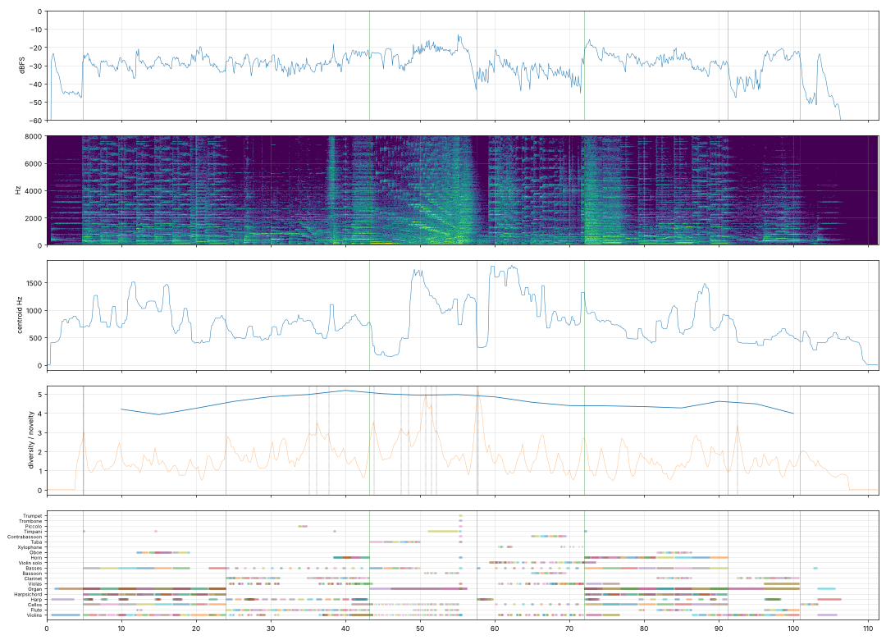

# Report: Ludus de Casu

- length 111.4 s; level p10/p50/p90 -39.4/-28.9/-22.1 dBFS; peak -1.0 dBFS
- gaps ≥ 1 s below −50 dBFS: none
- clipped samples: 0; isolated clicks at: none
- centroid median 709 Hz; share above 2 kHz median -14.2 dB
- flat stretches (diversity < 60 % of the median, 20 s windows): none
- strongest changes (novelty peaks), s: [5.0, 35.2, 36.2, 37.8, 43.8, 47.5, 48.5, 50.8, 51.5, 52.2, 57.8, 92.5]

## Score
- notes: 1219, parts: 20, densest 10 s: 231 notes at 50–… s
- outside the real range of the instrument (matters for live players): {'vln_spic': 7}
- more than 5 semitones beyond the recorded range (resampled, may sound artificial): none

## Balance (each part alone, LUFS while it plays; the tune and the bass usually within ±3 dB)

| part | LUFS |
|---|---|
| Flute | -25.3 |
| Horn | -25.6 |
| Violin solo | -26.4 |
| Bassoon | -26.8 |
| Violins | -26.9 |
| Trumpet | -28.0 |
| Clarinet | -29.0 |
| Harp | -29.9 |
| Piccolo | -30.3 |
| Timpani | -30.3 |
| Organ | -31.3 |
| Basses | -31.5 |
| Oboe | -31.5 |
| Cellos | -32.0 |
| Contrabassoon | -32.2 |
| Tuba | -33.0 |
| Xylophone | -33.3 |
| Harpsichord | -34.7 |
| Violas | -35.9 |
| Trombone | -39.4 |

