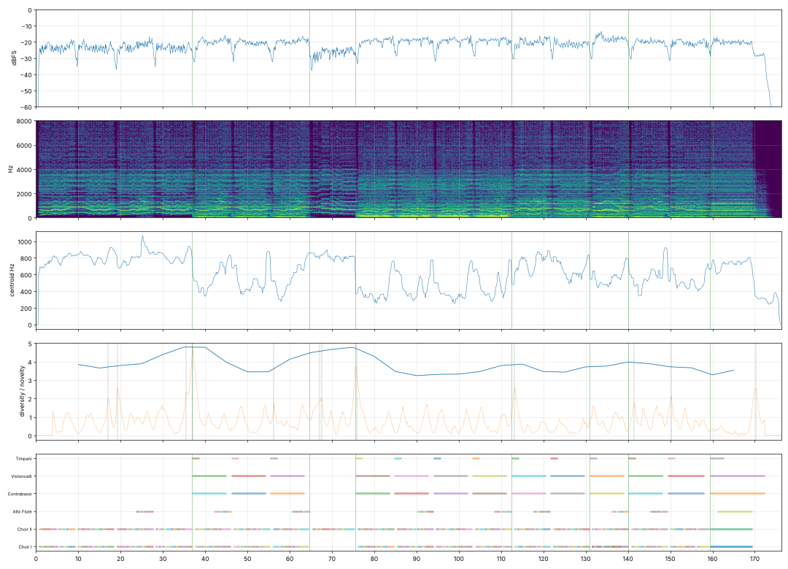

# Report: Namárië

- length 176.3 s; level p10/p50/p90 -27.0/-20.9/-18.3 dBFS; peak -1.0 dBFS
- gaps ≥ 1 s below −50 dBFS: none
- clipped samples: 0; isolated clicks at: none
- centroid median 631 Hz; share above 2 kHz median -20.1 dB
- flat stretches (diversity < 60 % of the median, 20 s windows): none
- strongest changes (novelty peaks), s: [17.0, 19.2, 35.5, 37.0, 56.2, 67.0, 67.5, 75.8, 113.2, 141.5, 150.2, 170.2]

## Score
- notes: 488, parts: 6, densest 10 s: 45 notes at 130–… s
- outside the real range of the instrument (matters for live players): none
- more than 5 semitones beyond the recorded range (resampled, may sound artificial): none

## Balance (each part alone, LUFS while it plays; the tune and the bass usually within ±3 dB)

| part | LUFS |
|---|---|
| Choir II | -28.5 |
| Alto Flute | -30.9 |
| Contrabassi | -31.3 |
| Choir I | -32.0 |
| Violoncelli | -35.5 |
| Timpani | -40.7 |

