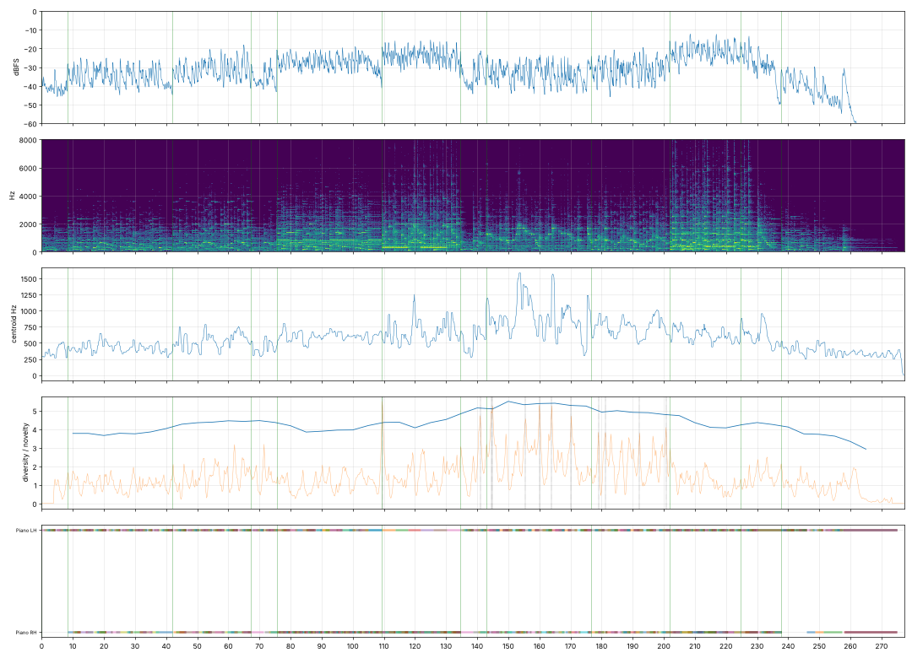

# Report: Nocturne à trois

- length 277.4 s; level p10/p50/p90 -41.2/-31.0/-22.3 dBFS; peak -1.0 dBFS
- gaps ≥ 1 s below −50 dBFS: none
- clipped samples: 0; isolated clicks at: none
- centroid median 545 Hz; share above 2 kHz median -29.6 dB
- flat stretches (diversity < 60 % of the median, 20 s windows): none
- strongest changes (novelty peaks), s: [109.5, 141.0, 144.5, 145.0, 155.5, 160.0, 164.0, 170.2, 179.0, 181.2, 192.2, 200.8]

## Score
- notes: 1118, parts: 2, densest 10 s: 81 notes at 110–… s
- outside the real range of the instrument (matters for live players): none
- more than 5 semitones beyond the recorded range (resampled, may sound artificial): none

## Balance (each part alone, LUFS while it plays; the tune and the bass usually within ±3 dB)

| part | LUFS |
|---|---|
| Piano RH | -37.3 |
| Piano LH | -43.1 |

