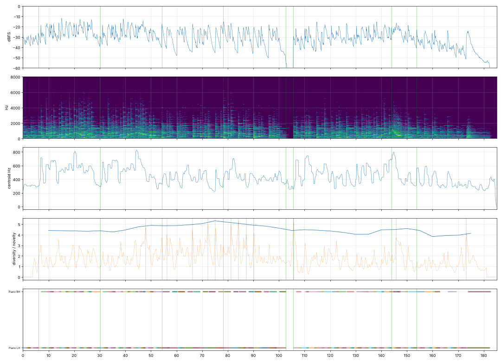

# Report: Неподвижный ноктюрн

- length 185.1 s; level p10/p50/p90 -43.3/-30.6/-20.4 dBFS; peak -1.0 dBFS
- gaps ≥ 1 s below −50 dBFS: none
- clipped samples: 0; isolated clicks at: none
- centroid median 425 Hz; share above 2 kHz median -34.8 dB
- flat stretches (diversity < 60 % of the median, 20 s windows): none
- strongest changes (novelty peaks), s: [48.0, 56.2, 66.2, 72.2, 75.2, 81.2, 84.2, 87.2, 90.2, 105.8, 145.8, 173.2]

## Score
- notes: 338, parts: 2, densest 10 s: 32 notes at 140–… s
- outside the real range of the instrument (matters for live players): none
- more than 5 semitones beyond the recorded range (resampled, may sound artificial): none

