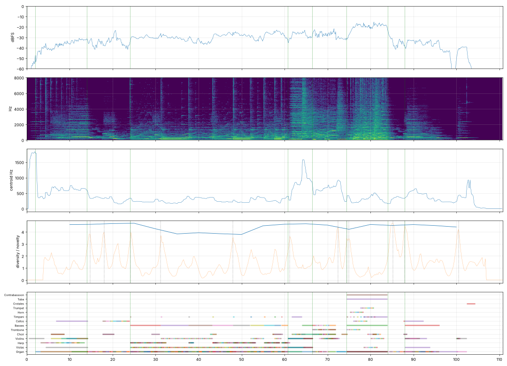

# Report: Novem Mutationes

- length 110.8 s; level p10/p50/p90 -40.7/-31.2/-24.1 dBFS; peak -1.0 dBFS
- gaps ≥ 1 s below −50 dBFS: none
- clipped samples: 0; isolated clicks at: none
- centroid median 330 Hz; share above 2 kHz median -26.1 dB
- flat stretches (diversity < 60 % of the median, 20 s windows): none
- strongest changes (novelty peaks), s: [14.8, 18.0, 24.2, 31.2, 48.0, 61.2, 72.5, 74.5, 75.0, 85.2, 88.0, 100.5]

## Score
- notes: 1016, parts: 14, densest 10 s: 210 notes at 50–… s
- outside the real range of the instrument (matters for live players): none
- more than 5 semitones beyond the recorded range (resampled, may sound artificial): {'vln_harm': 2}

## Balance (each part alone, LUFS while it plays; the tune and the bass usually within ±3 dB)

| part | LUFS |
|---|---|
| Choir | -23.8 |
| Basses | -25.1 |
| Timpani | -26.9 |
| Organ | -27.9 |
| Violins | -27.9 |
| Trumpet | -29.1 |
| Horn | -29.6 |
| Contrabassoon | -30.0 |
| Cellos | -30.5 |
| Trombone | -31.0 |
| Harp | -31.8 |
| Tuba | -33.2 |
| Violas | -34.0 |
| Crotales | -50.3 |

