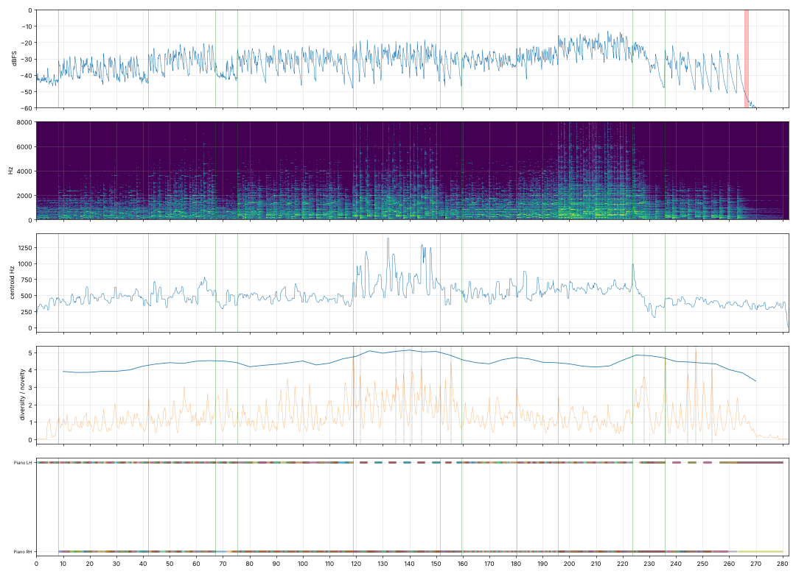

# Report: Prélude «Belle»

- length 282.4 s; level p10/p50/p90 -42.7/-31.7/-23.5 dBFS; peak -1.0 dBFS
- gaps ≥ 1 s below −50 dBFS: [(265.8, 267.1)]
- clipped samples: 0; isolated clicks at: none
- centroid median 481 Hz; share above 2 kHz median -27.5 dB
- flat stretches (diversity < 60 % of the median, 20 s windows): none
- strongest changes (novelty peaks), s: [119.0, 121.5, 135.0, 137.8, 141.0, 144.5, 155.5, 228.0, 236.0, 244.5, 247.5, 253.5]

## Score
- notes: 1555, parts: 2, densest 10 s: 96 notes at 180–… s
- outside the real range of the instrument (matters for live players): none
- more than 5 semitones beyond the recorded range (resampled, may sound artificial): none

## Balance (each part alone, LUFS while it plays; the tune and the bass usually within ±3 dB)

| part | LUFS |
|---|---|
| Piano RH | -34.3 |
| Piano LH | -37.6 |

