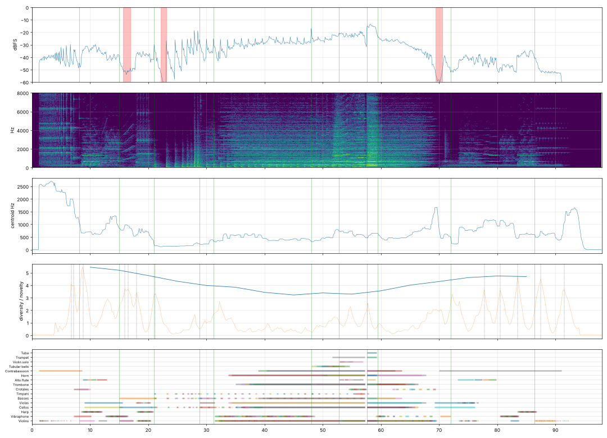

# Report: Protocollum Excitationis

- length 98.0 s; level p10/p50/p90 -50.8/-36.2/-24.4 dBFS; peak -1.0 dBFS
- gaps ≥ 1 s below −50 dBFS: [(15.7, 16.9), (22.1, 23.1), (69.4, 70.6)]
- clipped samples: 0; isolated clicks at: none
- centroid median 582 Hz; share above 2 kHz median -17.3 dB
- flat stretches (diversity < 60 % of the median, 20 s windows): none
- strongest changes (novelty peaks), s: [6.8, 7.2, 8.8, 16.0, 16.5, 18.0, 21.2, 77.8, 80.5, 83.5, 87.5, 91.5]

## Score
- notes: 661, parts: 16, densest 10 s: 110 notes at 10–… s
- outside the real range of the instrument (matters for live players): {'vla_harm': 2, 'tbn_sus': 6, 'cb_sus': 2}
- more than 5 semitones beyond the recorded range (resampled, may sound artificial): {'vc_harm': 2, 'vla_harm': 2}

## Balance (each part alone, LUFS while it plays; the tune and the bass usually within ±3 dB)

| part | LUFS |
|---|---|
| Trumpet | -24.3 |
| Contrabassoon | -24.6 |
| Horn | -25.2 |
| Alto flute | -25.5 |
| Tuba | -26.0 |
| Timpani | -26.8 |
| Cellos | -27.0 |
| Basses | -27.6 |
| Violas | -29.4 |
| Violins | -29.5 |
| Harp | -29.7 |
| Trombone | -29.9 |
| Violin solo | -30.5 |
| Tubular bells | -34.4 |
| Vibraphone | -35.3 |
| Crotales | -41.4 |

