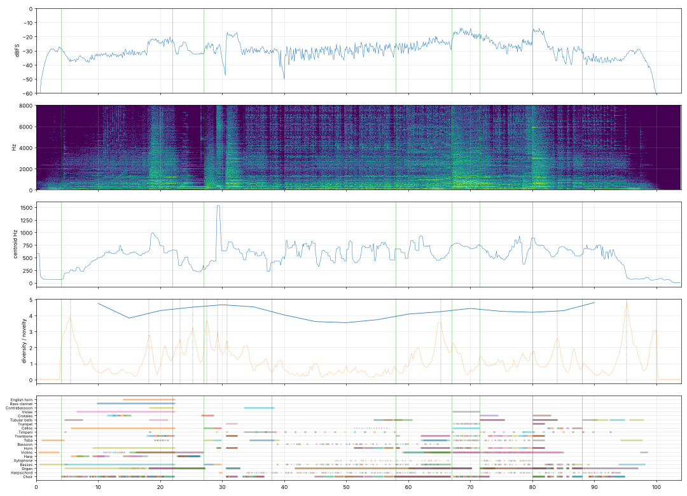

# Report: Ritus Cogitationis

- length 104.0 s; level p10/p50/p90 -36.6/-29.7/-21.6 dBFS; peak -1.0 dBFS
- gaps ≥ 1 s below −50 dBFS: none
- clipped samples: 0; isolated clicks at: none
- centroid median 557 Hz; share above 2 kHz median -16.1 dB
- flat stretches (diversity < 60 % of the median, 20 s windows): none
- strongest changes (novelty peaks), s: [5.5, 18.2, 23.2, 25.2, 27.5, 29.2, 30.8, 65.2, 84.0, 95.2, 100.0]

## Score
- notes: 1242, parts: 20, densest 10 s: 232 notes at 70–… s
- outside the real range of the instrument (matters for live players): none
- more than 5 semitones beyond the recorded range (resampled, may sound artificial): {'cb_sus': 3, 'tba_sus': 3}

## Balance (each part alone, LUFS while it plays; the tune and the bass usually within ±3 dB)

| part | LUFS |
|---|---|
| Choir | -18.1 |
| Horn | -24.6 |
| Trumpet | -25.2 |
| Tubular bells | -25.5 |
| Tuba | -25.6 |
| Timpani | -26.1 |
| Harpsichord | -26.3 |
| Organ | -27.3 |
| Contrabassoon | -27.9 |
| Crotales | -28.1 |
| Harp | -28.2 |
| Basses | -29.4 |
| Trombone | -29.4 |
| Cellos | -32.4 |
| Violins | -32.8 |
| Xylophone | -32.8 |
| Violas | -33.2 |
| Bassoon | -33.7 |
| Bass clarinet | -35.0 |
| English horn | -35.2 |

