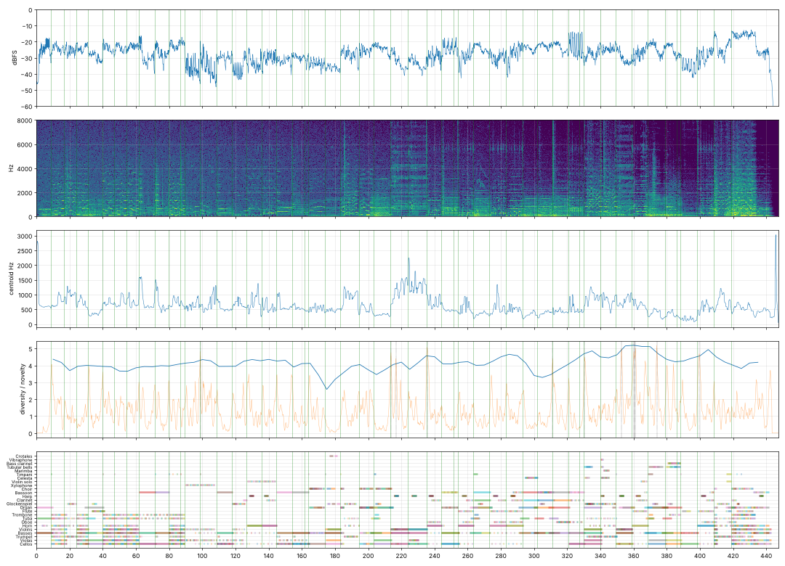

# Report: Р.С.Ф.Г.Р. 1920–2000 · третья редакция, вариант А

- length 447.4 s; level p10/p50/p90 -36.1/-27.2/-21.2 dBFS; peak -1.0 dBFS
- gaps ≥ 1 s below −50 dBFS: none
- clipped samples: 0; isolated clicks at: none
- centroid median 557 Hz; share above 2 kHz median -18.2 dB
- flat stretches (diversity < 60 % of the median, 20 s windows): none
- strongest changes (novelty peaks), s: [98.8, 213.8, 216.8, 235.5, 311.2, 330.5, 352.8, 360.2, 360.8, 361.2, 374.0, 399.8]

## Score
- notes: 2707, parts: 25, densest 10 s: 167 notes at 420–… s
- outside the real range of the instrument (matters for live players): {'tpt_sus': 2, 'harp': 2, 'tbn_sus': 1, 'tba_sus': 2}
- more than 5 semitones beyond the recorded range (resampled, may sound artificial): {'cb_sus': 9, 'tba_sus': 9}

## Balance (each part alone, LUFS while it plays; the tune and the bass usually within ±3 dB)

| part | LUFS |
|---|---|
| Trumpet | -24.9 |
| Choir | -25.0 |
| Bassoon | -26.0 |
| Horn | -26.8 |
| Cellos | -28.6 |
| Organ | -29.3 |
| Basses | -29.4 |
| Violas | -29.4 |
| Oboe | -30.3 |
| Clarinet | -30.6 |
| Marimba | -30.6 |
| Harp | -31.2 |
| Celesta | -31.3 |
| Flute | -32.1 |
| Timpani | -32.2 |
| Tuba | -32.2 |
| Bass clarinet | -32.4 |
| Violins | -33.8 |
| Violin solo | -34.2 |
| Trombone | -36.6 |
| Xylophone | -40.6 |
| Vibraphone | -41.0 |
| Tubular bells | -43.5 |
| Glockenspiel | -44.3 |
| Crotales | -60.7 |

