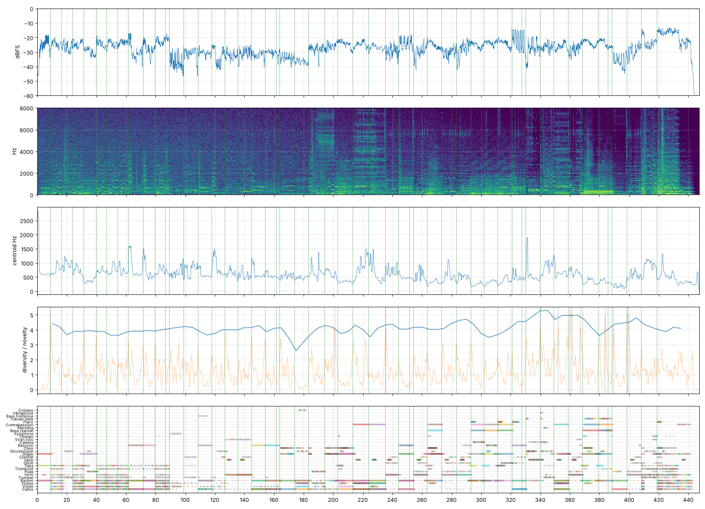

# Report: Р.С.Ф.Г.Р. 1920–2000 · третья редакция, вариант Б

- length 447.4 s; level p10/p50/p90 -34.8/-27.0/-21.6 dBFS; peak -1.0 dBFS
- gaps ≥ 1 s below −50 dBFS: none
- clipped samples: 0; isolated clicks at: none
- centroid median 544 Hz; share above 2 kHz median -18.2 dB
- flat stretches (diversity < 60 % of the median, 20 s windows): none
- strongest changes (novelty peaks), s: [9.0, 201.0, 235.5, 340.0, 352.2, 360.2, 361.2, 367.0, 384.0, 389.5, 399.0, 399.8]

## Score
- notes: 2974, parts: 28, densest 10 s: 187 notes at 410–… s
- outside the real range of the instrument (matters for live players): {'harp': 2, 'tbn_sus': 1, 'tba_sus': 2}
- more than 5 semitones beyond the recorded range (resampled, may sound artificial): {'cb_sus': 9, 'tba_sus': 9}

## Balance (each part alone, LUFS while it plays; the tune and the bass usually within ±3 dB)

| part | LUFS |
|---|---|
| Trumpet | -24.6 |
| Celesta | -25.1 |
| Bassoon | -25.7 |
| Choir | -26.1 |
| Horn | -27.3 |
| Cellos | -28.0 |
| Contrabassoon | -28.0 |
| Organ | -29.0 |
| Basses | -29.3 |
| Clarinet | -29.3 |
| Violas | -29.5 |
| Oboe | -29.7 |
| Piano | -30.2 |
| Marimba | -30.6 |
| Harp | -31.0 |
| Flute | -31.5 |
| Tuba | -31.7 |
| Timpani | -32.1 |
| Bass clarinet | -33.8 |
| Violin solo | -34.2 |
| Violins | -35.4 |
| Trombone | -36.8 |
| Bass trombone | -39.2 |
| Vibraphone | -41.0 |
| Xylophone | -41.2 |
| Tubular bells | -43.0 |
| Glockenspiel | -44.2 |
| Crotales | -60.7 |

