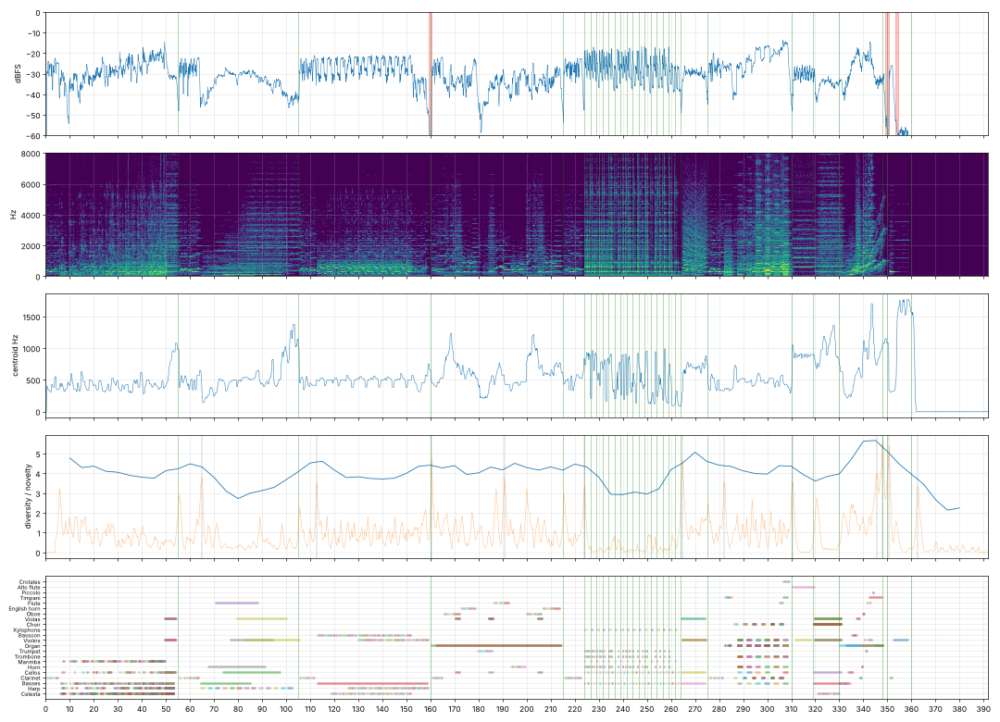

# Report: Tractatus: sieben Sätze

- length 392.0 s; level p10/p50/p90 -39.9/-29.9/-22.1 dBFS; peak -1.0 dBFS
- gaps ≥ 1 s below −50 dBFS: [(159.2, 160.4), (349.2, 350.6), (353.2, 354.5)]
- clipped samples: 0; isolated clicks at: none
- centroid median 493 Hz; share above 2 kHz median -25.0 dB
- flat stretches (diversity < 60 % of the median, 20 s windows): none
- strongest changes (novelty peaks), s: [65.0, 112.8, 160.5, 190.8, 224.0, 264.8, 282.2, 310.5, 345.8, 348.0, 350.8, 362.5]

## Score
- notes: 1418, parts: 22, densest 10 s: 189 notes at 40–… s
- outside the real range of the instrument (matters for live players): {'cb_pizz': 18, 'tbn_sus': 1}
- more than 5 semitones beyond the recorded range (resampled, may sound artificial): {'vln_harm': 10}

## Balance (each part alone, LUFS while it plays; the tune and the bass usually within ±3 dB)

| part | LUFS |
|---|---|
| Bassoon | -21.2 |
| Clarinet | -22.5 |
| Trumpet | -23.3 |
| Horn | -23.5 |
| Flute | -23.7 |
| Choir | -23.9 |
| Alto flute | -24.9 |
| Organ | -25.2 |
| Oboe | -25.3 |
| English horn | -25.4 |
| Harp | -26.4 |
| Cellos | -27.3 |
| Marimba | -27.6 |
| Piccolo | -27.7 |
| Violins | -27.9 |
| Basses | -28.9 |
| Timpani | -29.3 |
| Violas | -29.7 |
| Celesta | -31.6 |
| Xylophone | -32.4 |
| Trombone | -33.8 |
| Crotales | -37.9 |

