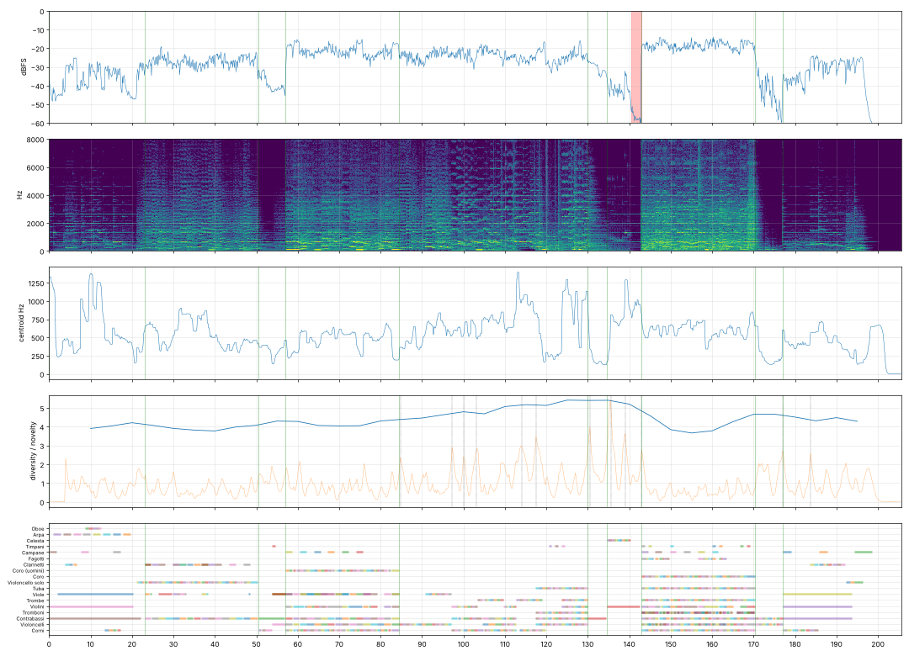

# Report: «Холодный мир» — тема СССР

- length 205.7 s; level p10/p50/p90 -42.1/-25.8/-18.3 dBFS; peak -1.0 dBFS
- gaps ≥ 1 s below −50 dBFS: [(140.4, 142.9)]
- clipped samples: 0; isolated clicks at: none
- centroid median 529 Hz; share above 2 kHz median -18.8 dB
- flat stretches (diversity < 60 % of the median, 20 s windows): none
- strongest changes (novelty peaks), s: [84.8, 97.2, 100.0, 103.2, 114.0, 117.5, 130.5, 135.5, 139.0, 143.0, 177.0, 183.8]

## Score
- notes: 907, parts: 18, densest 10 s: 137 notes at 150–… s
- outside the real range of the instrument (matters for live players): none
- more than 5 semitones beyond the recorded range (resampled, may sound artificial): {'vla_harm': 2}

## Balance (each part alone, LUFS while it plays; the tune and the bass usually within ±3 dB)

| part | LUFS |
|---|---|
| Coro | -23.1 |
| Coro (uomini) | -24.5 |
| Violoncelli | -24.8 |
| Trombe | -25.5 |
| Violoncello solo | -26.2 |
| Fagotti | -26.7 |
| Viole | -27.3 |
| Corni | -27.6 |
| Contrabassi | -28.4 |
| Oboe | -29.5 |
| Violini | -31.2 |
| Clarinetti | -31.9 |
| Tuba | -32.4 |
| Campane | -38.4 |
| Celesta | -38.9 |
| Arpa | -39.3 |
| Timpani | -40.8 |
| Tromboni | -41.0 |

